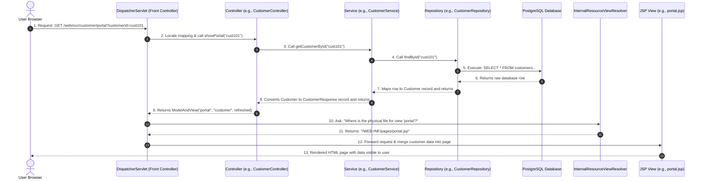

# Comprehensive Spring MVC Guide

This guide breaks down how Spring MVC operates, how the output is rendered on screen, how the layers communicate, and what each JAR file does in your project.

---

## 1. The Big Picture: How Spring MVC Works (Request Lifecycle)

Spring MVC follows the **Front Controller Design Pattern**. The central brain is Spring's `DispatcherServlet`.

Here is the exact path a request takes when a user clicks a button or submits a form:



---

## 2. The Configuration Files: `web.xml` and `mvc-servlet.xml`

### A. `web.xml` (The Deployment Descriptor)
This is the first file Tomcat reads when starting your application. It registers the servlet container:
* **Registers `DispatcherServlet`:** We define a servlet named `mvc` and link it to Spring's framework.
* **URL Mapping (`/webmvc/*`):** Tells Tomcat that *any* URL starting with `/webmvc/` must be routed directly to Spring's `DispatcherServlet`.

### B. `mvc-servlet.xml` (Spring Configuration)
This file configures Spring-specific behavior for the servlet named `mvc`:
1. **Component Scanning:**
   ```xml
   <context:component-scan base-package="com.ecommerce" />
   ```
   Tells Spring to automatically scan your code and instantiate classes annotated with `@Controller`, `@Service`, and `@Repository` as Spring Beans.
2. **View Resolver Configuration:**
   ```xml
   <bean class="org.springframework.web.servlet.view.InternalResourceViewResolver">
       <property name="prefix" value="/WEB-INF/pages/" />
       <property name="suffix" value=".jsp" />
   </bean>
   ```
   When a controller returns a view name like `"login"`, this automatically appends the prefix and suffix to find the physical file: `/WEB-INF/pages/login.jsp`.
3. **DataSource Bean:**
   Configures the database credentials and driver class. Spring instantiates this `DriverManagerDataSource` bean and injects it into our repositories via `@Autowired`.

---

## 3. Traversing Through the Code Layers

Our code is divided into three distinct layers to keep it clean and maintainable:

| Layer | Responsibility | Key Annotations Used |
| :--- | :--- | :--- |
| **Controller** | Handles user requests, reads inputs, and returns views. | `@Controller`, `@RequestMapping`, `@RequestParam` |
| **Service** | Processes business logic (calculates totals, validates credit/stock). | `@Service`, `@Autowired` |
| **Repository** | Runs raw SQL commands using JDBC to interact with the database. | `@Repository`, `@Autowired` |

### Code Traversal Example (Placing an Order):
1. **Controller:** `OrderController` receives `productNo`, `quantity`, and `customerId` from the checkout form POST request. It calls:
   ```java
   orderService.placeOrder(customerId, productNo, quantity);
   ```
2. **Service:** `OrderService` performs the business rules:
   * Asks `productRepository` for the product details.
   * Checks if `stock >= quantity`.
   * Asks `customerRepository` for the customer credit.
   * Checks if `credit >= (price * quantity)`.
   * Subtracts quantity from stock and updates the database.
   * Subtracts cost from customer credit and updates the database.
   * Creates and saves the new `Order` object.
3. **Repository:** `OrderRepository` opens a raw JDBC connection, runs `INSERT INTO orders...`, and returns the newly generated order number.

---

## 4. What Each JAR File Does

Here is a list of the libraries configured under `WEB-INF/lib` and their roles:

| JAR File Group | Specific Files | What it does |
| :--- | :--- | :--- |
| **Spring Core Container** | `spring-core`, `spring-beans`, `spring-context`, `spring-expression`, `commons-logging` | Provides dependency injection (automatically instantiating and wiring classes together via `@Autowired` and managing Bean lifecycles). |
| **Spring Web & MVC** | `spring-web`, `spring-webmvc`, `javax.servlet-api` | Implements the web features, registers `DispatcherServlet`, handles URL mappings, and handles controllers/requests. |
| **Spring Database Support** | `spring-jdbc`, `spring-tx` | Provides transaction management helpers and Spring's `DriverManagerDataSource` configuration class. |
| **Database Drivers** | `postgresql-xxx.jar`, `mysql-connector-java-xxx.jar` | The vendor-specific translators that allow Java classes to speak SQL and run commands on PostgreSQL or MySQL databases. |
| **JSP Rendering (JSTL)** | `jstl-1.2.jar` | Enables standard tag expressions in JSPs (like `<c:forEach>` loops, `<c:choose>`, and `<c:if>`). |
